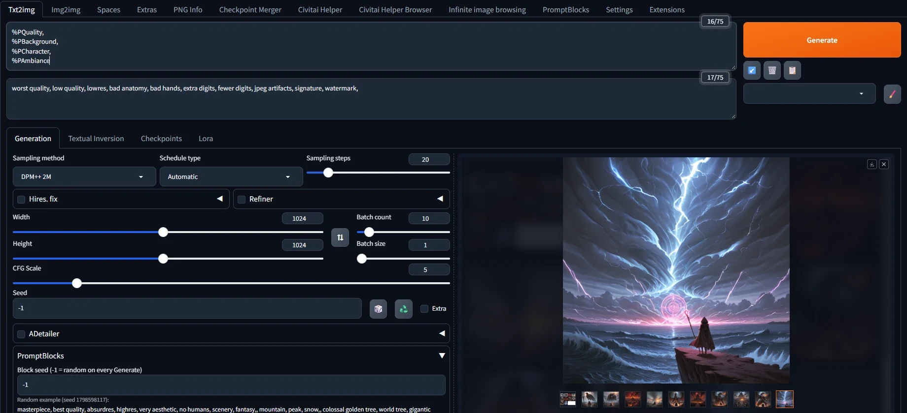
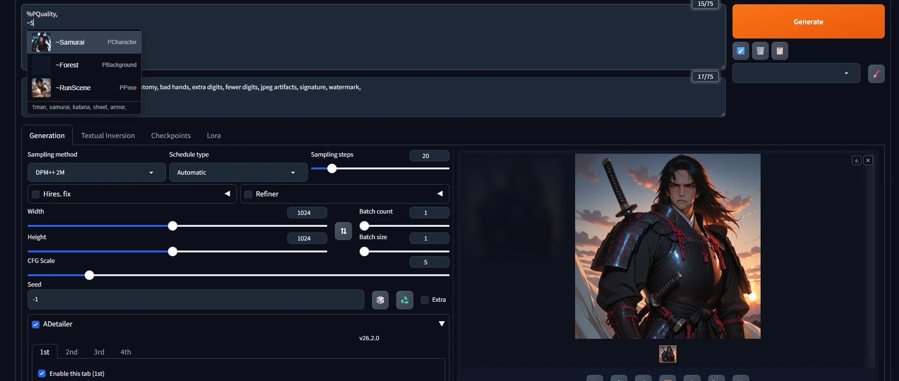
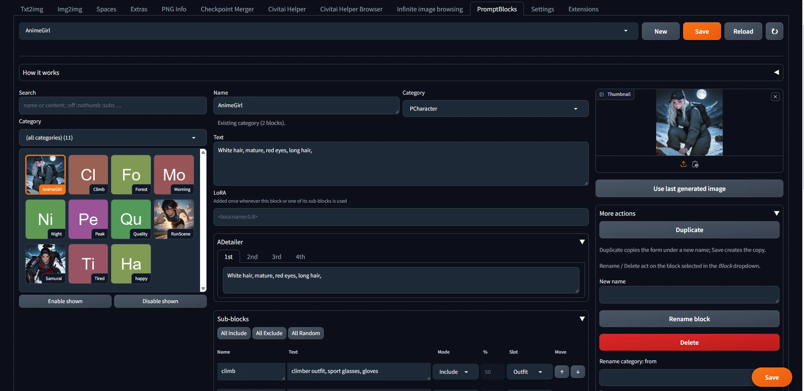

# SD PromptBlocks

Reusable, modular prompt blocks for **Stable Diffusion WebUI Forge**.


*A prompt made only of `%Category` calls: every image of the batch gets its own random picks.*

Save prompt fragments (tags, LoRAs, ADetailer texts) as named blocks grouped in categories, then call them
in the prompt with a short syntax. An autocomplete popup, thumbnails and an in-UI editor replace
hand-edited wildcard `.txt` files.

```
~Quality, ~Samurai, %PBackground, %PAmbiance
```
→ the `Quality` and `Samurai` blocks' text (plus their sub-blocks and LoRA), one random active block of the
`PBackground` and one of the `PAmbiance` category, in the order written.


*Type `~` or `%` in the prompt box: the popup lists matching blocks with thumbnails and shows the highlighted block's text.*


*The PromptBlocks tab: block browser with search and thumbnails, the block form with sub-blocks and ADetailer text.*

<p align="center">
  
  
</p>
<p align="center"><em>Example images made with PromptBlocks prompts.</em></p>

## Features

- **Prompt syntax**
  - `~name` – insert a block.
  - `%Category` – insert one random active block of a category (weighted).
  - `~name.sub` – insert only one sub-block; `~name*slot` – one random sub-block from a slot.
  - Blocks can reference other blocks (nesting depth limit 5).
- **Sub-blocks** (up to 6 per block) with modes *Include* / *Exclude* / *Random* (with a % chance) and
  *slots* (at most one sub-block per slot).
- **Autocomplete popup** in the txt2img / img2img prompt boxes: opens on `~` / `%`, shows thumbnails and
  the highlighted block's content, keyboard and mouse.
- **Preview** of one example expansion, with warnings for unknown names, all-inactive categories and bans.
- **Reproducible randomness**: a separate *Block seed*; the template, seed and per-image picks are written
  to the image infotext, and *Pin last picks* turns the random picks of the last image into fixed `~name` calls.
- **Bans**: a block can forbid other blocks or whole categories in the same prompt
  (banned picks are redrawn).
- **LoRA per block**, added once per prompt; optional **ADetailer** text per block and tab, and
  *Keep main LoRAs in ADetailer* to avoid a second LoRA merge.
- **Management tab**: block browser with content search and quick filters (`:off`, `:nothumb`, `:bans`, …),
  thumbnails, form with auto-save, duplicate / rename (updates references) / delete with warnings,
  bulk tools, health check, automatic backups with restore.

## Requirements

- Stable Diffusion WebUI **Forge** (tested on `f2.0.1v1.10.1-previous-669-gdfdcbab6`, Gradio 4.40, Python 3.10).
- Not supported: AUTOMATIC1111 (Gradio 3), ComfyUI.
- Optional: [ADetailer](https://github.com/Bing-su/adetailer) for the ADetailer features.

## Installation

1. In Forge: **Extensions → Install from URL**, paste this repository's URL, press **Install**.
   (Or clone it into `stable-diffusion-webui-forge/extensions/`.)
2. Restart Forge.
3. On the first start the extension creates `data/blocks.json` with 11 example blocks in 6 categories
   (with a few thumbnails, sub-blocks, a ban and an ADetailer text to look at). Open the **PromptBlocks** tab
   to edit or delete them, or type `~` in a prompt box.

## Your data

Everything you create stays in the extension's `data/` folder (`blocks.json`, `thumbs/`, `backups/`).
These files are ignored by git, so updating the extension never overwrites them.
A backup of `blocks.json` is written before every save (the newest 20 are kept).

## Development

- Unit tests (pure Python, no WebUI needed): `python -m pytest` in the extension folder.
- `devtools/browser/`: headless-Chrome scenarios for the tab and the JavaScript
  (run with Forge's own Python, see its README).

## License

[MIT](LICENSE)
